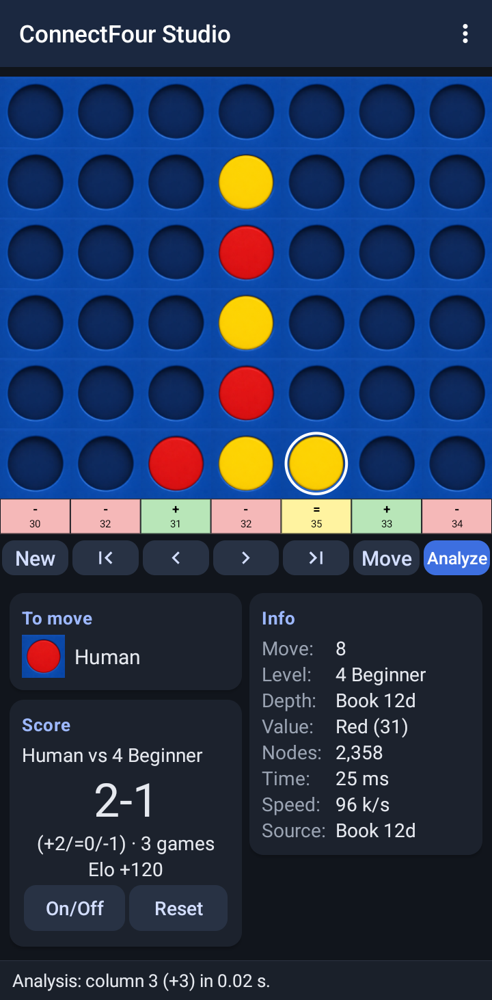
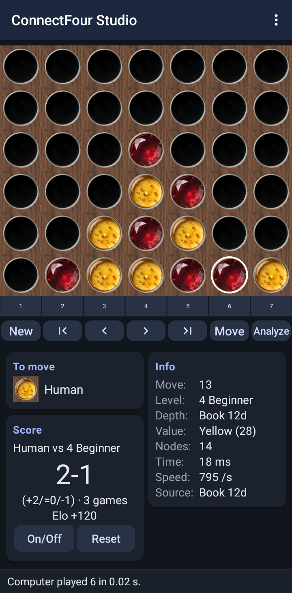
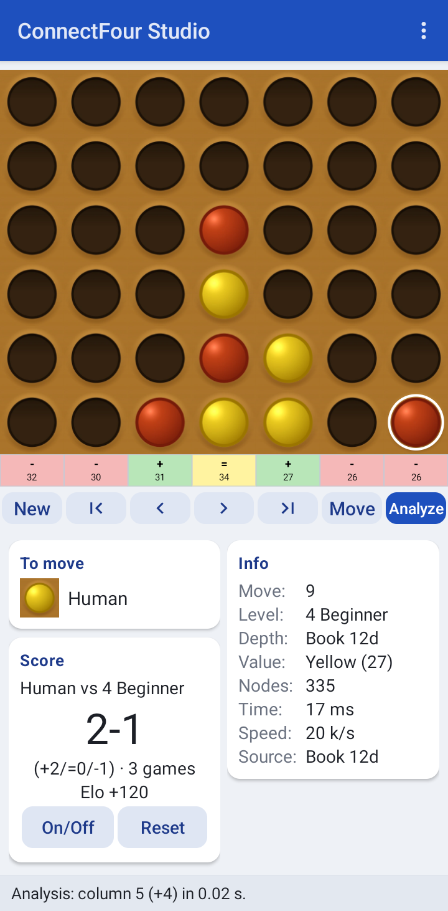

# ConnectFour Studio for Android

*Open-source Connect Four with a perfect engine, real-time analysis, 15
levels, match mode and 20 boards – the Android version of
[ConnectFour Studio](https://github.com/Patrick-Ric/connectfour-studio-qt).*

**Download:** [latest release](https://github.com/Patrick-Ric/connectfour-studio-android/releases/latest)
(APK, Android 5.0+, about 6.4 MB) · F-Droid: inclusion in review

<p>
  
  
  
</p>

## Features

- **Play against the computer** on 15 levels, from *0 Loser* (a joke level
  that tries to lose) and *1 Random* up to *14 Perfect* – Connect Four is
  solved, and the top level plays perfectly
- **Real-time analysis:** for every column, whether the move wins (+), draws
  (=) or loses (−) and in how many moves; can be switched off
- **Computer-vs-computer matches** between any two levels with Elo estimate,
  and a session score (with Elo) for your own games
- Undo/redo, save and load positions (`.4gp`, same format as the desktop
  version), new game from a random position
- 20 stone sets (switch with a two-finger swipe across the board), light and
  dark theme, large-board option, built-in help
- 6 languages: English, German, French, Spanish, Dutch, Italian
- **No permissions at all** – no internet, no tracking, no ads

## Install

1. Download `ConnectFourStudio-<version>.apk` from the
   [latest release](https://github.com/Patrick-Ric/connectfour-studio-android/releases/latest)
   on your phone (or copy it there).
2. Open it and allow installing apps from this source when Android asks.

On the very first start the opening book is unpacked once ("Preparing the
opening book …", about a second).

The app is also being added to F-Droid
([merge request](https://gitlab.com/fdroid/fdroiddata/-/merge_requests/51839)).
F-Droid will ship the same developer-signed APK (reproducible build), so you
can later switch between the GitHub and the F-Droid version without
reinstalling.

## Technical details

- **Engine:** Kotlin port of [BitBully](https://github.com/MarkusThill/BitBully)
  by Markus Thill (bitbully 0.0.79, C++ core) with the 12-ply-dist opening
  book – same scores *and* node counts as the original engine (checked by the
  unit tests)
- **Own mini book "2-ply-dist" (Buch 2d):** exact scores of all moves for the
  57 positions with 0–2 stones, computed once with a full search of the
  original engine (`scripts/gen_minibook.py`) and compiled into the app – so
  the opening moves, which a full search would take longest for, are
  analysed instantly
- **App:** Kotlin, Android framework only (no AndroidX, no Material library,
  no other runtime dependencies), minSdk 21 (Android 5.0), targetSdk 37
- Feature comparison with the desktop version: [FEATURES.md](FEATURES.md);
  design decisions: [DECISIONS.md](DECISIONS.md)

### Project layout

- `core/` – pure Kotlin/JVM module (no Android): game and `.4gp` format,
  BitBully engine port (`engine/`), levels (p, s, w), engine move choice,
  match and session score; JUnit tests incl. comparison with the Python engine
- `app/` – Android app: `Controller` (game flow, port of the Qt `MainWindow`),
  `BoardView` (Canvas), `MainActivity`, `MatchActivity`, `HelpActivity`
- `app/src/main/res/values*/strings.xml`, `res/raw*/help.json`,
  `assets/sets/`, `assets/book/` – generated from the desktop sources (see
  `scripts/`), committed so that the build needs no Python
- `scripts/` – generators: `gen_resources.py` (texts, help, stone sets),
  `encode_book.py` (opening book), `gen_engine_reference.py` (test reference
  data from the Python engine), `gen_minibook.py` (mini book), `gen_icons.py`
  (PNG icons)
- `fastlane/` – store texts, icon and screenshots (used by F-Droid);
  `docs/fdroid-metadata.yml` – the fdroiddata recipe

### Build

Requirements: Android SDK with platform `android-37` and build-tools
`36.0.0`, a JDK 21 (Gradle selects it via `gradle/gradle-daemon-jvm.properties`;
the wrapper itself may start on any JDK ≥ 17).

```bash
echo "sdk.dir=$HOME/Android/Sdk" > local.properties
```

```bash
export JAVA_HOME=/usr/lib/jvm/java-21-openjdk
```

```bash
./gradlew test lint assembleDebug assembleRelease
```

Results:

- `app/build/outputs/apk/debug/app-debug.apk` – debug build (debug-signed)
- `app/build/outputs/apk/release/app-release-unsigned.apk` – release build,
  unsigned, minified with R8
- Test report: `core/build/reports/tests/test/index.html`
- Lint report: `app/build/reports/lint-results-debug.html`

Testing with adb and emulators: [docs/TESTING.md](docs/TESTING.md).
Publishing a new version (signing, GitHub release, F-Droid):
[docs/RELEASING.md](docs/RELEASING.md).

## License and credits

GNU AGPL v3 ([LICENSE](LICENSE)); assets and their licenses: [ASSETS.md](ASSETS.md).

- Engine: **BitBully by Markus Thill** – https://github.com/MarkusThill/BitBully (AGPL v3)
- Opening book: **bitbully-databases** (`12-ply-dist`) by Markus Thill – MIT
- Navigation icons: Material Icons by Google – Apache 2.0
- Desktop program, stone sets, texts and help: ConnectFour Studio by Patrick Götz
  ([Qt version](https://github.com/Patrick-Ric/connectfour-studio-qt),
  [Tk version](https://github.com/Patrick-Ric/connectfour-studio))
